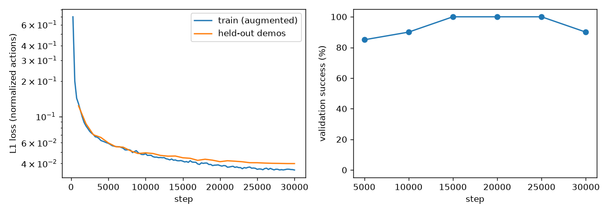
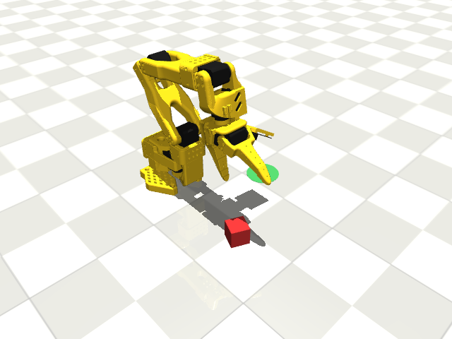

# SO-101 Robot Arm: Simulation, IK, and Imitation Learning

A MuJoCo simulation of the low-cost **SO-101** robot arm (the LeRobot arm)
that picks up a cube from a random spot and places it on a target. A scripted
controller built on **inverse kinematics** does the task first. Its recorded
demonstrations then train a small **behavior-cloning** neural network that
does the same task from camera images alone, and the two are compared over 50
unseen episodes.

## Results

50 evaluation episodes with cube poses never seen in training (seeds 0–49):

| Policy | What it sees | Success | 95% CI |
|---|---|---|---|
| Scripted IK expert | exact cube pose from the simulator | **50/50 (100%)** | 93–100% |
| Behavior cloning | 2 cameras + joint angles only | **46/50 (92%)** | 81–97% |

- Policy used: `checkpoints/bc_policy.pt`, saved at **step 25,000** of 30,000.
  It was chosen because it had the best validation success (100% on 20
  validation episodes, tied with steps 15k and 20k; ties go to the later step).
  The final step-30k model scored 90% on validation, so it was *not* used.
- Training: 200 demos, 30k steps, **30 minutes on the M4 Pro's GPU (MPS)**.
- All 4 failures look the same: the policy brings the gripper down to the cube
  but the grasp is slightly misaligned. It nudges the cube instead of closing
  on it, then hovers without retrying (there are no retry examples in the
  demos). Three of the four cubes were at the inner edge of the spawn area.
- Note: the comparison isn't apples-to-apples. The scripted expert gets the
  true cube pose; the learned policy must find the cube in pixels.

Videos (front camera, wrist camera in the top-right corner):
[scripted expert](videos/eval_scripted.mp4) ·
[learned policy](videos/eval_bc_policy.mp4) ·
[learned policy failure, seed 23](videos/eval_bc_policy_failure_seed23.mp4)



Full per-episode numbers: [results/eval_results.json](results/eval_results.json).



## Tools and libraries

| Tool | Why |
|---|---|
| **MuJoCo 3** (`mujoco`) | Fast, accurate physics for contact-rich manipulation; free; official Python bindings with headless rendering on macOS. |
| **MuJoCo Menagerie SO-101 model** | Ready-made, curated model of the real arm (meshes, joint limits, servo gains, wrist camera), so the sim matches the hardware. |
| **NumPy** | Arrays for IK math, demo storage and data processing. |
| **PyTorch** (MPS backend) | Trains the policy on the Mac's Apple-Silicon GPU. |
| **imageio + imageio-ffmpeg** | Writes MP4 videos without a system `ffmpeg` install. |
| **matplotlib** | Training-curve plot. |
| **pytest** | Tests for IK, the environment and the policy. |

## File structure

```
robot-arm-sim/
├── README.md                  This file
├── DECISIONS.md               Log of design choices and why they were made
├── requirements.txt           Pinned Python packages
├── pyproject.toml             pytest configuration
├── .gitignore                 Keeps data, checkpoints, secrets and caches out of git
├── assets/so101/
│   ├── so101.xml              SO-101 robot model (unchanged, from MuJoCo Menagerie)
│   ├── assets/*.stl           Robot meshes (from Menagerie)
│   ├── LICENSE, README.md     Menagerie's Apache-2.0 license and model notes
│   └── scene_pick_place.xml   Our scene: floor, lights, cube, target disc, front camera
├── robot_arm_sim/
│   ├── __init__.py            Makes the folder a Python package
│   ├── env.py                 PickPlaceEnv: reset with random cube, step, cameras, success check
│   ├── ik.py                  Damped-least-squares inverse kinematics solver
│   ├── render.py              Step 1: load the arm, save an image and a joint-sweep video
│   ├── scripted.py            IK-based scripted pick-and-place expert
│   ├── record.py              Records expert demos (joints + camera frames + actions)
│   ├── policy.py              CNN + spatial-softmax behavior-cloning network and runtime agent
│   ├── train.py               Trains the policy on MPS, keeps the best checkpoint
│   └── evaluate.py            Scripted vs learned policy on 50 unseen episodes, saves videos
├── tests/
│   ├── test_ik.py             IK round trips, joint limits, reachability, rotation math
│   ├── test_env.py            Environment resets and the scripted expert
│   └── test_policy.py         Network shapes, spatial softmax, augmentation, agent
├── results/                   Evaluation tables, JSON and training curves (generated)
├── videos/                    Rendered videos (generated)
├── data/demos/                Recorded demonstrations (generated, git-ignored)
└── checkpoints/               Trained weights (generated, git-ignored)
```

## Setup

```bash
conda create -n robot-arm-sim python=3.11 -y
conda activate robot-arm-sim
pip install -r requirements.txt
```

Tested on a MacBook Pro (M4 Pro, 24 GB) with macOS. No GPU drivers needed:
PyTorch uses Apple's **MPS** backend automatically and falls back to CPU.

## How to run

Each step can be run on its own, in this order:

```bash
python -m robot_arm_sim.render                  # 1. load + render -> videos/scene.png, joint_sweep.mp4
python -m robot_arm_sim.scripted --episodes 5   # 2. scripted IK pick-and-place -> videos/scripted.mp4
python -m robot_arm_sim.record --episodes 200   # 3. record demos -> data/demos/  (~15 min)
python -m robot_arm_sim.train --steps 30000     # 4. train policy -> checkpoints/ (~30 min on M4 Pro)
python -m robot_arm_sim.evaluate --episodes 50  # 5. compare policies -> results/, videos/
```

Run the tests:

```bash
pytest
```

## How it was built

1. **Load and render.** Copied the SO-101 model from MuJoCo Menagerie, wrote a
   scene around it (floor, cube, green target disc, front camera), and checked
   offscreen rendering works on macOS.
2. **Inverse kinematics.** Wrote a damped-least-squares IK solver using
   MuJoCo's Jacobian, mapped which floor positions a top-down gripper can
   reach, and wrote tests (FK→IK round trips, joint limits, reachability).
3. **Scripted pick-and-place.** Turned 8 gripper waypoints (above → down →
   close → lift → carry → lower → open → back off) into joint angles with IK,
   connected by smooth minimum-jerk motions. 100/100 successes.
4. **Record demonstrations.** Ran the scripted expert on 200 random cube poses
   and saved joint angles, both camera images and the expert's actions at
   every 50 ms step. Small action noise was added so the data includes
   recoveries.
5. **Train behavior cloning.** A small CNN-with-spatial-softmax network learns
   to map (images, joint angles) → next 10 actions, trained on the Mac GPU
   (MPS). The best checkpoint is picked by trying it in the simulator on
   validation seeds.
6. **Evaluate.** Both policies run on the same 50 unseen cube poses; success
   rates, failure types and videos are saved.

Every design choice (and the numbers behind it) is in [DECISIONS.md](DECISIONS.md).

## Key concepts

### Forward vs. inverse kinematics
- **Forward kinematics (FK):** joint angles → where the gripper is. Easy:
  multiply the transforms link by link (MuJoCo does it for us).
- **Inverse kinematics (IK):** where I want the gripper → which joint angles.
  Hard: there may be several answers, or none, and no simple formula.
- **How we solve it (damped least squares):** start from a guess and repeat:
  1. measure the error between where the gripper is and where it should be;
  2. get the **Jacobian** J, a table of "if joint *i* moves a little, the
     gripper moves this much";
  3. step the joints by `dq = Jᵀ (J Jᵀ + λ² I)⁻¹ · error`.
  This is a least-squares solve. The **damping λ** stops huge steps when the
  arm is nearly straight (a *singularity*, where J loses rank).
- **Joint limits and local minima:** we clip to limits, drop joints that are
  pinned against a limit, and retry from random starts if stuck.
- **5 joints, not 6:** the SO-101 can't reach every position *and*
  orientation (that takes 6). Top-down grasps still work because the arm is
  planar: the base picks the plane, three pitch joints set height, reach and
  tilt, and wrist roll lines the jaw up with the cube.

### Imitation learning / behavior cloning
- **Idea:** instead of programming the robot, *show* it. Record an expert
  (here, the scripted controller; on a real robot, a person teleoperating)
  and train a network with ordinary supervised learning: input =
  observation, label = the expert's action.
- **Why it's interesting:** the scripted expert cheats. It reads the exact
  cube position from the simulator. The learned policy only gets **camera
  pixels and joint angles**, like a real robot, so it has to learn to *see* the cube.
- **Compounding error (distribution shift):** a cloned policy makes small
  mistakes, which lead to states the expert never visited, which cause
  bigger mistakes. Fixes used here: noise injection during recording (DART),
  predicting **action chunks** with temporal ensembling (ACT), and image
  augmentation.
- **Spatial softmax:** turns each CNN feature map into an (x, y) "where is it"
  coordinate, a good bias for manipulation.
- **Evaluate by rollouts, not loss:** low validation loss doesn't guarantee
  success. Only running the policy in the simulator tells you. With 50
  episodes, a success rate has roughly ±10–14% uncertainty (95% CI shown in
  the results table).

### What changes on the real SO-101
- **Calibration and units:** real servos report raw ticks (0–4095). LeRobot's
  calibration maps them to angles, and its zero pose and joint directions must
  be matched to this MJCF (Menagerie's model follows LeRobot's
  `so101_new_calib` convention, but verify each joint's sign and offset).
- **Servo behaviour:** the STS3215 gains, torque limit, backlash (~0.5°) and
  delay differ from the simulated `position` actuators. Expect position
  errors of a few mm, which matters for a 3 cm cube. Tune `kp`/`forcerange` in
  the MJCF to match recorded step responses, or add randomization.
- **Perception (the biggest gap):** the scripted expert used the true cube
  pose. On hardware you'd need a detector plus camera calibration
  (intrinsics + camera-to-robot transform), or skip the expert and record
  **human teleoperation** with the SO-101 leader arm, the normal LeRobot
  workflow. Real images have different lighting, textures, blur and
  backgrounds, so a policy trained only on these renders will not transfer
  directly. Options: train on real demos (typically 50–100), co-train on sim +
  real, or domain-randomize the sim (colours, lights, camera pose).
- **Camera placement:** the real front and wrist cameras must match the sim
  (pose, field of view, resolution), or the policy must be retrained.
- **Timing:** the policy runs at 20 Hz. On hardware, inference + camera +
  servo bus latency must fit in 50 ms. This tiny network is fast on a laptop,
  but camera latency is real.
- **Safety:** add joint-velocity limits, workspace bounds and an emergency
  stop. A wrong prediction in sim costs nothing; on hardware it can hit the
  table.
- **Grasp physics:** real friction, cube mass and the jaw's soft contact
  differ. The force-limited squeeze used here is a reasonable start.
